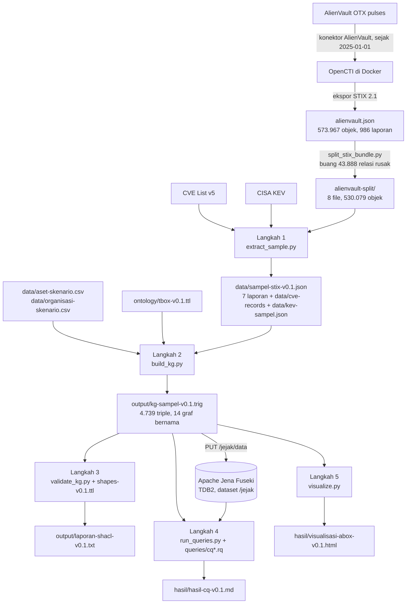

# Alur Data: dari OpenCTI sampai Jawaban CQ

## 1. Akuisisi (di luar repositori)

| Tahap | Apa yang terjadi | File |
|---|---|---|
| Konektor | OpenCTI mengimpor *pulse* AlienVault OTX setiap 6 jam, mulai 1 Januari 2025 (`ALIENVAULT_PULSE_START_TIMESTAMP`). Setiap *pulse* menjadi satu laporan STIX beserta aktor, *malware*, teknik, CVE, sektor, negara, dan *indicator*. | [`infrastruktur/opencti/docker-compose.yml`](../infrastruktur/opencti/docker-compose.yml), [`.env.example`](../infrastruktur/opencti/.env.example) |
| Ekspor | Seluruh isi diekspor menjadi satu *bundle* STIX 2.1 (`alienvault.json`, 573.967 objek). | — |
| Pemecahan | [`split_stix_bundle.py`](../infrastruktur/opencti/scripts/split_stix_bundle.py) membuang relasi yang ujungnya tidak ada di *bundle* (43.888 relasi), mengambil semua objek yang dirujuk setiap laporan secara rekursif, lalu menyimpannya per ±48 MiB. Objek yang tidak dirujuk laporan mana pun tidak terbawa. | `infrastruktur/opencti/README.md` bagian "Alur data D1" |

Akibat penting untuk penelitian: **setiap objek di data terikat pada minimal satu
laporan**, sehingga laporan (beserta tanggal terbitnya) bisa dijadikan satuan bukti.

## 2. Sampel dan konstruksi KG (di repositori)

| Langkah | Masukan | Keluaran | Penjelasan |
|---|---|---|---|
| 1 | 8 file potongan, CVE List v5, KEV | `data/sampel-stix-v0.1.json` (7 laporan), `data/cve-records/` (14 rekaman), `data/kev-sampel.json` (18 entri) | [Panduan Langkah 1](02-panduan-kode.md#langkah-1--extract_samplepy-mengambil-sampel) |
| 2 | Hasil langkah 1, aset skenario, T-box | `output/kg-sampel-v0.1.trig` | [Panduan Langkah 2](02-panduan-kode.md#langkah-2--build_kgpy-pemetaan-ke-rdf) |
| 3 | TriG, `shapes/shapes-v0.1.ttl` | `output/laporan-shacl-v0.1.txt` | [Panduan Langkah 3](02-panduan-kode.md#langkah-3--validate_kgpy-validasi-shacl) |
| 4 | TriG atau Fuseki, `queries/*.rq` | `hasil/hasil-cq-v0.1.md` | [Panduan Langkah 4](02-panduan-kode.md#langkah-4--run_queriespy-menjalankan-cq) |
| 5 | TriG | `hasil/visualisasi-abox-v0.1.html` | [Panduan Langkah 5](02-panduan-kode.md#langkah-5--visualizepy-visualisasi-a-box) |

## 3. Kenapa tanggal diambil dari laporan

Atribut `created` pada setiap relasi STIX di ekspor ini adalah **waktu impor ke OpenCTI**
(semuanya Maret 2026), bukan waktu ancaman dilaporkan. Sebaliknya, `created` dan
`published` laporan sama dengan tanggal terbit *pulse* (Februari–Desember 2025). Karena
itu, waktu bukti setiap pernyataan diambil dari tanggal terbit laporan yang memuatnya
(`ext:published`). Angka lengkapnya ada di
[`data-checks/kuant01_opencti_prototype_findings.out.txt`](../data-checks/kuant01_opencti_prototype_findings.out.txt)
bagian A.
